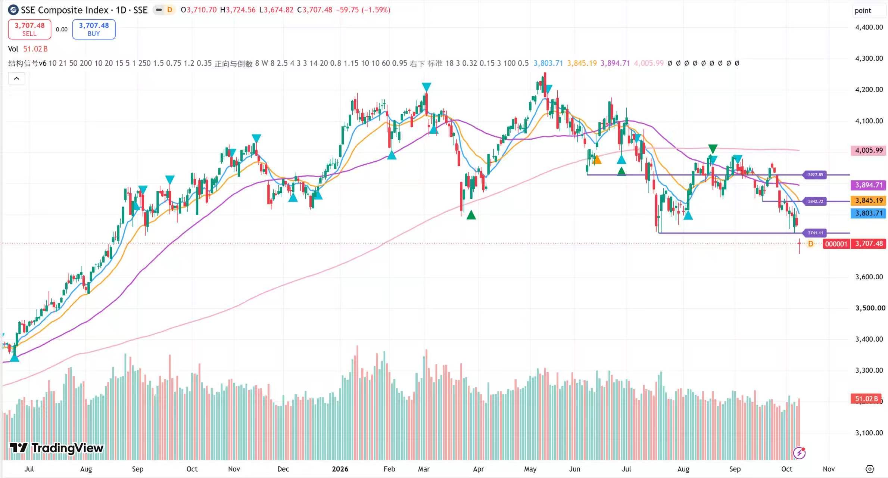

# Willow's Daily Dashboard

跨市场行情与信号看板，覆盖A股、美股、港股、韩股和日股。页面按市场展示宏观指标、行业与主题ETF、个股信号、止盈提醒和止损提醒，支持代码或名称搜索、运行时点切换、表头双向排序与ETF、个股分页；比特币纳入美股宏观观察。

## 看板预览

## 系统流程

基本面股票池→量化信号筛选→看图确认→手动下单。

以基本面研究维护核心股票池，围绕盈利质量、行业景气、竞争优势和估值建立持续跟踪名单，并结合宏观指标与行业ETF观察市场环境。量化策略依据均线与价格结构，识别支撑反弹、趋势启动、放量突破和多头回踩等机会，同时跟踪止盈与止损条件，将研究范围收敛为需要重点查看的标的。

日常在本地运行策略，将输出结果更新至看板，按市场和运行时点进行查阅。对触发信号的标的进一步查看原始K线，结合关键价位、趋势结构、财报事件与持仓风险进行人工复核，确认交易计划后手动下单。基本面决定关注范围，量化规则提高筛选效率，最终交易由人工判断与执行。

## 完善方向

**全天候永续合约监测。**接入加密货币交易所的永续合约行情与K线数据，建立每周7天、每天24小时连续运行的监测流程。统一交易对、时间戳和K线更新口径，完善断线重连、数据补齐与异常检查，使信号计算在传统市场休市期间持续运行；结合永续合约的杠杆与资金费率特征，逐步细化风险约束。

**多周期信号共振。**将同一套均线与价格结构规则分别应用于4小时线、日线和周线，以周线判断趋势背景、日线识别交易结构、4小时线细化触发时点。建立跨周期方向一致性、信号新鲜度及关键价位的联合筛选机制，优先关注多个周期相互确认的机会，并单独标识周期冲突。通过历史回测与持续跟踪评估共振筛选对信号有效性、回撤和交易频率的影响，逐步提高信号质量与交易决策的一致性。

